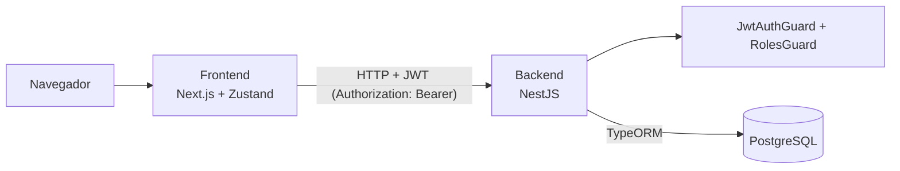

# Pawlie

Plataforma web que conecta a **dueños de mascotas** con **cuidadores** de confianza en Colombia: búsqueda de cuidadores, reservas, seguimiento del servicio en tiempo real y reseñas.

Proyecto del curso · Equipo: **Cristina Jauregui, Felipe y Ospina**.

## Funcionalidades principales

| # | Funcionalidad | Rol |
|---|---|---|
| F1 | Buscar cuidadores y reservar un servicio (mascota → servicio → fecha → confirmación) | Dueño |
| F2 | Gestionar mascotas, disponibilidad y solicitudes (aceptar, rechazar, cancelar) | Dueño y cuidador |
| F3 | Seguimiento del servicio en tiempo real y reseña al finalizar | Dueño y cuidador |

**Roles:** `OWNER` (dueño de mascota) y `CAREGIVER` (cuidador).

**Estados de una solicitud:** `PENDIENTE → ACEPTADA → EN_CURSO → FINALIZADA`. Desde `PENDIENTE` o `ACEPTADA` también puede pasar a `RECHAZADA` o `CANCELADA`.

## Arquitectura



| Capa | Tecnología |
|---|---|
| Frontend | Next.js 16, React 19, Tailwind CSS, Zustand, lucide-react |
| Backend | NestJS 11, TypeORM, Passport + JWT, bcrypt, class-validator |
| Base de datos | PostgreSQL 16 (Docker) |
| Pruebas | Jest y Supertest |

**Modelo de datos:** `users`, `caregiver_profiles`, `pets`, `services`, `availability`, `requests`, `service_updates`, `reviews`.

## Cómo correr el proyecto

Requisitos: **Node 24** (`nvm use` toma la versión de `.nvmrc`) y **Docker Desktop**.

```bash
# 1. Variables de entorno (llenar los valores; nunca subir el .env)
cp .env.example .env

# 2. Base de datos
docker compose up -d db

# 3. Backend → http://localhost:3000
cd backend
npm install
npm run migration:run
npm run seed          # datos demo (opcional)
npm run start:dev

# 4. Frontend → http://localhost:3001 (en otra terminal)
cd frontend
cp .env.example .env.local
npm install
npm run dev
```

## Usuarios demo

Se crean con `npm run seed`. Contraseña de todas las cuentas: **`Pawlie123`**.

| Correo | Rol |
|---|---|
| maria@pawlie.com | Dueña (mascotas Max, Luna y Nube) |
| camila@pawlie.com | Cuidadora (San Fernando, Cali) |
| andres@pawlie.com | Cuidador (Ciudad Jardín, Cali) |

## Pruebas

```bash
cd backend
npm test              # pruebas unitarias
npm run test:e2e      # pruebas de integración (usan la base <POSTGRES_DB>_test)
```

La primera vez hay que crear la base de pruebas:

```bash
docker compose exec db createdb -U <POSTGRES_USER> <POSTGRES_DB>_test
```

## Colección de Postman

`postman/Pawlie.postman_collection.json`. Importarla en Postman y ejecutar primero **Auth → Iniciar sesión**: el token se guarda solo en la variable `{{token}}` y lo usan las demás peticiones.

## Documentación

| Documento | Contenido |
|---|---|
| [docs/autenticacion.md](docs/autenticacion.md) | Registro, login, JWT, roles y cómo proteger endpoints |
| [docs/seguimiento.md](docs/seguimiento.md) | Seguimiento del servicio, reseñas y datos demo |
| [frontend/README.md](frontend/README.md) | Estructura del frontend, rutas y cómo crear pantallas |

## Despliegue

- Backend: _pendiente (URL)_
- Frontend: _pendiente (URL)_

## Responsables

| Integrante | Funcionalidad | Partes técnicas |
|---|---|---|
| Cristina Jauregui | Autenticación, dashboard del dueño, seguimiento y servicio finalizado | Login con JWT y roles, reseñas, datos demo, base del frontend |
| Felipe | F1: búsqueda de cuidadores, reservas y solicitudes | Entidades y migración inicial |
| Ospina | F2: mascotas, disponibilidad, dashboard del cuidador y actualizaciones del servicio | Docker, CI, interceptor de logging y filtro global de errores |

## Limitaciones conocidas y trabajo futuro

- Ubicación del cuidador en un mapa en tiempo real (hoy se muestra la línea de tiempo de actualizaciones).
- Inicio de sesión con Google o Facebook y recuperación de contraseña.
- Mensajes entre dueño y cuidador, y sección de consejos.
- Subir fotos de mascotas y cartilla de vacunación (hoy se usa una foto según la especie).
- Pagos en línea.

## Declaración de uso de IA

### Cristina Jauregui

En mi parte del proyecto (autenticación, seguimiento del servicio, reseñas y frontend base) trabajé paso a paso con Claude (Anthropic) como asistente de programación.

Fui construyendo cada parte por etapas: le pedía una funcionalidad, el asistente generaba el código y me explicaba cómo funcionaba, y yo lo probaba, pedía ajustes y lo integraba al proyecto. También me guió paso a paso para configurar el entorno, probar la API en Postman y subir los cambios con ramas y pull requests.

**Lo que hice yo:**

- Definí qué hacer y tomé las decisiones de diseño: el rol en una pantalla aparte, las reseñas guardadas en el backend, la línea de tiempo en lugar del mapa y los datos de Colombia en pesos colombianos.
- Revisé cada resultado y pedí correcciones (íconos en lugar de emojis, colores, tipografía y fotos del Figma).
- Probé los endpoints en Postman y armé la colección de la carpeta Auth.
- Integré mi trabajo con el de mis compañeros.
- Estudié el código para poder explicarlo y modificarlo en la sustentación.

### Felipe

_Pendiente._

### Ospina

_Pendiente._
